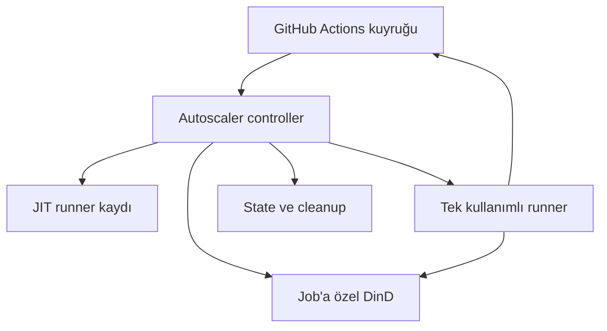

# Mimari

## Amaç

GitHub-hosted dakika kotasına bağlı kalmadan, `aga-b` hesabındaki izin verilen
repoların Linux CI işlerini ihtiyaç anında açılan tek kullanımlı runner'larda
çalıştırmak. Boş runner bekletilmez; her işin çalışma alanı, Docker daemon'ı
ve ağı birbirinden ayrıdır.

## Bileşenler

| Bileşen | Sorumluluk |
|---|---|
| Controller | Repo ve kuyruk keşfi, kapasite planlama, JIT kaydı, lifecycle ve cleanup |
| Runner container | GitHub Actions job'unu bir kez çalıştırır |
| DinD container | Yalnızca ilgili job'a ait Docker daemon ve service container'ları |
| GitHub App | Repo envanteri, Actions okuma ve runner yönetimi için kısa ömürlü token |
| State dizini | Provisioning journal, durum, drain bayrağı ve sınırlı loglar |

## Ölçekleme algoritması

Controller varsayılan olarak 30 saniyede bir Actions kuyruğunu tarar. Sadece
`[self-hosted, linux, x64, ci-linux]` etiketlerini isteyen işleri sayar. Aktif ve
henüz iş almamış runner'lar kapasiteden düşülür; kalan slotlar repolar arasında
round-robin dağıtılır. Global ve repo başına limit ayrıdır.

Mevcut host profili:

| Ayar | Değer |
|---|---:|
| Host CPU | 4 vCPU, Intel i7-9700 |
| Host RAM | 15 GiB |
| Host disk | 118 GB |
| `MAX_RUNNERS` | 2 |
| `MAX_RUNNERS_PER_REPO` | 4 |
| Runner limiti | 2 CPU / 4 GiB |
| DinD limiti | 1 CPU / 2 GiB |
| Repo yenileme | 300 saniye |

`MAX_RUNNERS_PER_REPO=4` gelecekteki daha büyük hostlar için tavanı tanımlar;
mevcut durumda global 2 limiti her zaman önce uygulanır.

## Job izolasyonu

Her slotta `work`, `externals` ve `tools` volume'ları; bir bridge network; bir
DinD ve bir runner container'ı oluşur. Runner, DinD'nin network namespace'ini
paylaştığı için GitHub `services:` portları `127.0.0.1` üzerinden erişilebilir.
Paralel işler aynı host portunu kullanabilse de farklı namespace'lerde kalır.

Host Docker socket'i sadece controller'a verilir. Runner bunu görmez. DinD
`privileged` olduğundan bu yapı bir VM güvenlik sınırı sayılmaz; host sadece
güvenilen CI işlerine ayrılmalı ve üretim ağlarına erişimi kısıtlanmalıdır.

## Lifecycle ve hata toleransı

- JIT runner tek job için kaydedilir.
- Tamamlanan runner'ın console ve `_diag` logları alınır.
- Container, network, volume ve GitHub runner kaydı temizlenir.
- Controller restart sonrası Docker label'ları ve journal dosyalarıyla aktif
  slotları sahiplenir; çalışan işi sonlandırmaz.
- API kesintisinde runner boşta varsayılıp erkenden silinmez.
- Kısmi provisioning slotu kapasitede tutulur ve güvenli cleanup beklenir.
- Varsayılan idle timeout 10 dakika, mutlak job ömrü 3 saattir.

## Güven sınırı

GitHub App private key yalnızca controller'da bulunur. Runner sadece encoded JIT
config alır. Public repolarda dış katkı için onay politikası zorlanır; fork PR,
izin verilmeyen aktör ve `pull_request_target` işleri otomatik kapasite alamaz.
